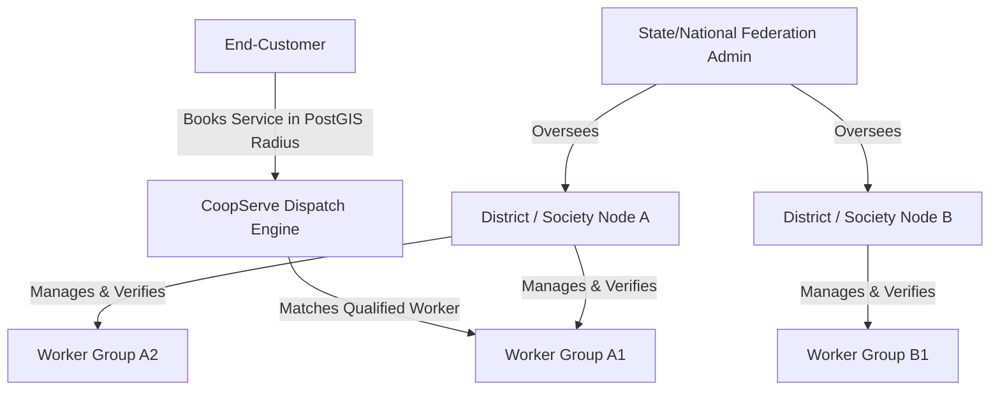
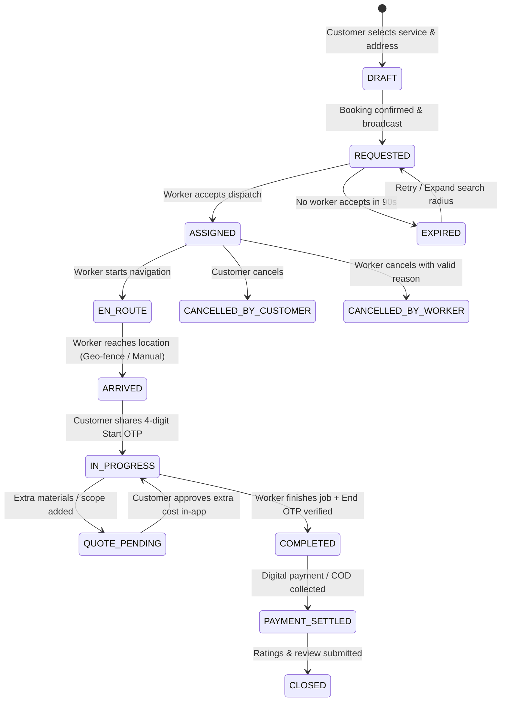
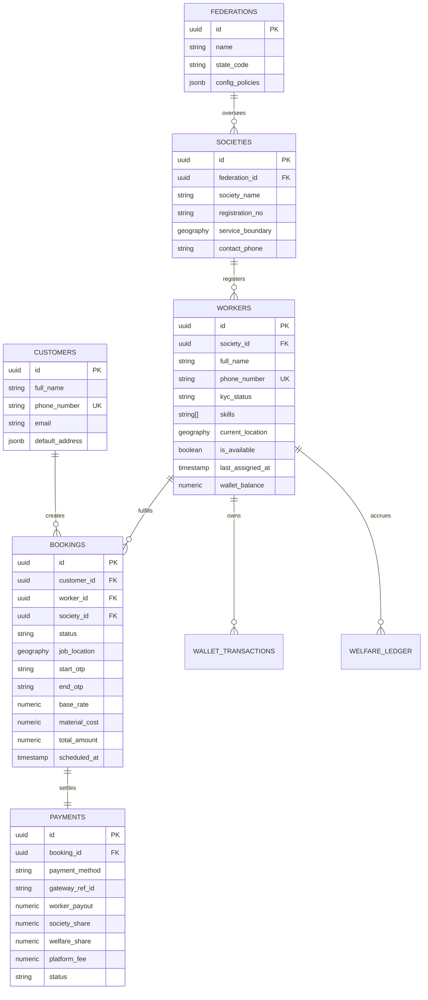

# Software Requirements Specification (SRS)
## Cooperative Service Marketplace (CoopServe)

**Document Version:** 1.1  
**Status:** Approved Specification  
**Target Application:** Cooperative Digital Service Marketplace Platform  
**Authors:** CoopServe Product & Engineering Group  

---

## 1. Executive Summary & Product Vision

### 1.1 Purpose
This Software Requirements Specification (SRS) establishes the functional, operational, architectural, and security requirements for **CoopServe**, an open, cooperative-owned digital service marketplace platform. It bridges the gap between certified gig workers in labour cooperative societies and residential/commercial service seekers.

### 1.2 The Problem & Value Proposition
Private aggregator platforms frequently impose exorbitant commission cuts (25–35%), obscure ranking algorithms, and lack social security safety nets for workers. CoopServe transforms the informal gig economy by:
* **Worker Welfare First:** Directing platform margins into micro-insurance (health/accidental/life), pension funds, and skill development.
* **Transparent Split Accounting:** Enforcing an auditable revenue split across worker wages, society maintenance, welfare contributions, and minimal platform overheads.
* **Cooperative Federation Governance:** Empowering local societies with administrative tools to verify credentials, resolve disputes locally, and control local rate cards.
* **Fair Work Allocation:** Replacing punitive ranking algorithms with radius-based, skill-certified, fair-dispatch algorithms.

---

## 2. Multi-Tenant Organizational Hierarchy & Actors

### 2.1 Organizational Structure
CoopServe operates on a 3-tier federated multi-tenancy model:



### 2.2 User Classes and Permissions (RBAC Matrix)

| User Class | Description | Primary Responsibilities & Access |
| :--- | :--- | :--- |
| **End-Customer** | Residential or business client seeking services | Search services, request on-demand or scheduled jobs, track worker GPS, pay digitally/cash, rate work. |
| **Cooperative Worker** | Verified artisan/labourer belonging to a certified society | Toggle availability, accept/decline dispatch requests, verify start/end via OTP, manage digital wallet, track welfare & insurance. |
| **Society Admin** | Local Labour Cooperative Society Manager | Physical KYC verification, document approval, local dispute mediation, worker equipment loans, cash balance reconciliation. |
| **Federation Admin** | Regional/State Apex Cooperative Authority | Macro revenue analytics, state-wide welfare fund governance, base rate card policies, AI dispatch policy configuration. |
| **Platform Superadmin** | System operations & DevOps team | Infrastructure monitoring, payment gateway configurations, global logs, security auditing. |

---

## 3. End-to-End Booking Lifecycle & State Machine

### 3.1 Job Lifecycle Diagram



### 3.2 State Transition & Verification Rules

1. **Dispatch Broadcast (`REQUESTED`):**
   * Targeted to qualified, available workers within a configured radius (default: 5 km; expands to 10 km on retry).
   * Workers receive a 45-second acceptance window before the job rolls to the next eligible candidate.
2. **Start of Work Verification (`IN_PROGRESS`):**
   * The customer receives a secure 4-digit **Start OTP** on their mobile app and SMS.
   * Work state cannot transition to `IN_PROGRESS` until the worker enters this exact OTP.
3. **Material Cost & Scope Modification (`QUOTE_PENDING`):**
   * If additional parts or tasks are needed, the worker enters the itemized extra cost with photo receipts in the worker app.
   * The customer receives an instant approval prompt. If accepted, the updated total is locked into the final invoice.
4. **Completion & Handover (`COMPLETED`):**
   * The customer provides a 4-digit **End OTP** and approves the checklist.
5. **Cancellation Policies:**
   * **Customer cancels after `EN_ROUTE`:** Flat convenience cancellation fee charged (credited to worker for fuel/travel).
   * **Worker cancels after `ASSIGNED`:** Marked against worker acceptance score; persistent unjustified cancellations trigger society admin review.

---

## 4. Financial Architecture & Split Accounting

### 4.1 Automated Payment Split Formula

For every completed service invoice $T$ ($T = \text{Base Labor} + \text{Extra Approved Materials}$):

$$\text{Total Invoice } (T) = W_{\text{wage}} + S_{\text{society}} + M_{\text{welfare}} + P_{\text{platform}} + C_{\text{materials}}$$

* **Worker Wage ($W_{\text{wage}}$):** $82\%$ of Base Labor.
* **Society Fee ($S_{\text{society}}$):** $8\%$ of Base Labor (used for local society administration and worker tools).
* **Worker Welfare & Micro-Insurance ($M_{\text{welfare}}$):** $5\%$ of Base Labor (credited directly to worker's insurance/pension fund).
* **Platform Operations ($P_{\text{platform}}$):** $5\%$ of Base Labor (cloud infrastructure, SMS/GPS gateway maintenance).
* **Materials Reimbursement ($C_{\text{materials}}$):** $100\%$ passed through directly to worker.

### 4.2 Cash on Delivery (COD) & Worker Wallet Reconciliation
To support unbanked workers and cash-paying customers without financial leakages:
* Every worker maintains a **Prepaid Security Wallet** within the app.
* When a customer pays **Cash on Delivery (COD)**, the worker receives $100\%$ cash in hand.
* The system instantly deducts $(S_{\text{society}} + M_{\text{welfare}} + P_{\text{platform}})$ from the worker's digital wallet.
* If a worker's wallet balance falls below the negative credit limit (e.g., $-\$20$ or $-₹1500$), dispatch is temporarily paused until they replenish the wallet online or through their Society Admin node.

### 4.3 Payout Cycles
* **Digital Gateway Payments:** Aggregated and settled directly to worker bank accounts / UPI handles on a daily $T+1$ cycle or instant withdrawal request.

---

## 5. Functional Requirements Specification

### 5.1 Onboarding, Identity & KYC
* **FR-01 (Biometric / ID Verification):** Workers must submit government identity documents (Aadhaar / National ID / Driving License) and trade certificates.
* **FR-02 (Society Approval Gate):** Worker accounts remain in `PENDING_VERIFICATION` status until physically validated and signed off by their assigned Society Admin.
* **FR-03 (Customer Registration):** Customer onboarding via Mobile Phone OTP with address auto-completion via reverse geo-coding.

### 5.2 Geo-Spatial Matching & Fair Dispatch Engine
* **FR-04 (PostGIS Spatial Queries):** Find candidate workers using PostGIS spatial indexing:
  ```sql
  SELECT id, ST_Distance(current_location, ST_MakePoint(cust_lng, cust_lat)::geography) AS dist_meters
  FROM workers
  WHERE is_active = true 
    AND is_available = true 
    AND skill_category = 'ELECTRICAL'
    AND ST_DWithin(current_location, ST_MakePoint(cust_lng, cust_lat)::geography, 5000)
  ORDER BY last_assigned_at ASC, dist_meters ASC
  LIMIT 10;
  ```
* **FR-05 (Fair Work Distribution):** Dispatch algorithms must prioritize qualified workers with fewer daily hours over saturated workers to ensure equitable income distribution across cooperative members.

### 5.3 Safety, SOS & Dispute Resolution
* **FR-06 (Emergency SOS):** A single-tap SOS button in both apps initiates:
  1. Live GPS tracking broadcast to Society Admin dashboard.
  2. Automated emergency SMS with location coordinates to configured emergency contacts.
* **FR-07 (Number Masking):** Direct phone communication between customer and worker is proxied through an in-app VoIP / virtual masked phone number to protect worker and customer privacy.
* **FR-08 (Service Guarantee & Warranty):** Customers can raise a rework request within a 48-hour service warranty window. Society Admins mediate and dispatch inspection if required.

### 5.4 Offline & Low-Connectivity Resilience
* **FR-09 (Offline Job View):** The worker mobile app must cache active job details (customer name, address, job notes) locally using SQLite / Hive, allowing workers to access critical data in zero-connectivity areas (e.g., basements).
* **FR-10 (SMS Fallback OTP):** When push notifications or data connections fail, OTPs and emergency status updates are transmitted via standard SMS channels.

---

## 6. Database Schema & Data Models (PostgreSQL + PostGIS)



---

## 7. Non-Functional & Security Requirements

### 7.1 Performance & Scalability
* **API Response Time:** Geo-spatial search and dispatch queries must return within `< 1.5 seconds` at the 95th percentile.
* **Location Sync:** Worker coordinates during `EN_ROUTE` must sync every 10 seconds with optimized delta compression to save battery and network bandwidth.
* **Concurrency:** Architecture must support 50,000 concurrent active socket connections for real-time tracking.

### 7.2 Security, Privacy & Compliance
* **Data Encryption:** All sensitive personal data (PII) encrypted at rest with AES-256 and in transit with TLS 1.3.
* **Data Protection Compliance:** Compliant with national data privacy standards (DPDP Act / GDPR), ensuring data minimization and secure storage of KYC documents in private, signed-URL storage buckets.
* **Audit Logging:** Every financial transaction, payout split, and dispute resolution must produce an immutable audit log entry.

---

## 8. MVP Delivery Plan (Phased Milestones)

### Phase 1: Core MVP (Current Focus)
* Multi-tenant data models (Federation, Society, Worker, Customer).
* Society Admin onboarding & Worker KYC verification portal.
* Geo-location radius search & booking dispatch engine.
* End-to-end booking state machine with Start/End OTP verification.
* Digital payment gateway integration with 4-way split calculations.
* Cross-platform Worker and Customer mobile apps.

### Phase 2: Financial Inclusion & Operations (v1.1)
* Worker prepaid wallet & COD cash reconciliation system.
* Micro-insurance welfare ledger & claims tracking.
* In-app VoIP / masked calling and real-time chat.
* Multi-language UI support with localized voice prompts.

### Phase 3: Intelligence & Scale (v2.0)
* AI-driven demand prediction and preemptive workforce rebalancing.
* Dynamic cooperative surge/incentive models.
* Automated dispute arbitration and voice-assisted booking UI.
